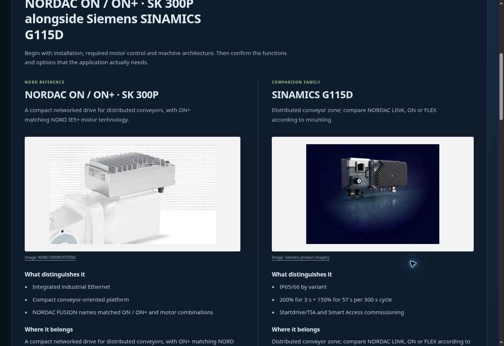

# NORD Motor and Drive Explorer

A self-contained, single-file interactive atlas for drive and motor engineering: power circuits, modulation,
motor physics, encoder and tuning behaviour, functional safety, communications, motor failure, and now
**cables, motor wiring and drive-family comparisons**.

Open `NORD-motor-and-drive-explorer.html` in any modern browser. No build step, no server, no dependencies.
Everything — styles, SVG scenes, models, embedded reference documents — lives in the one file, including the product photographs.

## The motor failure chapter

Chapter 43, **Where motors fail — evidence, mechanism and the trip**, sits under the Motor lesson
(`#motor`) in the lesson menu and is deep-linkable at:

```
NORD-motor-and-drive-explorer.html#motor-failure
```

It is one section, not a reading page followed by a separate animation. Selecting a failure family
switches the evidence, the traces and the simulation together:

- five failure families and their published shares — bearings, stator winding, rotor, shaft/coupling,
  application and environment;
- a clickable, animated motor cross-section where each mechanism moves differently: bearing rattle with
  impact rings and local heat, stator arcing with charred coils and smoke, rotor speed wobble with a hot
  bar and growing crack, shaft orbit with eccentric offset, and cooling loss with a slowing fan and broad
  heat — damage overlays appear only for their own family;
- a drive panel with READY → WARN → ALARM → TRIP, protection LEDs, health bar, estimated time to trip and
  the protection code;
- a spectrum-signature panel (1×, 2×, BPFO, f(1±2s), 2×line) with a lime dominant bar, hover explanations
  and a dynamic "what this signature means" line, plus live vibration, current and winding temperature
  traces, so you can see which channel moves first;
- the evidence chain for the selected family: primary stress, first test, prevention;
- live hot-spot temperature and Montsinger insulation-life readouts, plus the NEMA unbalance derating
  background in the reference cards;
- nine reference cards, including a worked spectrum example (1475 rpm, 50 Hz, s ≈ 1.7 %) and field
  photographs of an overheated stator and a squirrel-cage rotor.

Controls: failure family, time scale (1× / 4× / 12×), start with 0–95 % damage, Pause and Reset.
The simulation is a teaching model, not a reliability prediction or settings advice. The numbers are built
on published rules (IEC 60034, IEEE 43/1415, ISO 20816, NEMA MG 1, EASA AR100).

Below the stage, every chapter's notes and reference cards are laid out as a single-column article (a
720 px measure) with larger type, section headings and full-width figures, so long explanations read as
prose instead of being squeezed into a card grid.

## The wiring and cables chapter

Chapter 44, **Wiring, cables and connectors**, has its own **Cables and wiring** group in the journey and
the Chapters menu. It is deep-linkable at:

```
NORD-motor-and-drive-explorer.html#cables-connectors
NORD-motor-and-drive-explorer.html#wiring
```

The simplified layout also shows **Wiring & cables** as a top-level tab in the topic bar, so the chapter is
reachable without opening the Chapters menu. The home journey has a direct **Wiring and cables** button.
Inside the chapter, use the **Section** selector to move between seven views:

- **Connection chain** — separate versus hybrid routes from drive to motor, with power, brake, thermistor
  and encoder circuits, plus moving signal-flow markers when the transport runs.
- **Motor cable** — a cross-section with U/V/W/PE, brake and thermistor pairs, overall shield, and a
  shield-termination comparison.
- **Encoder cable** — incremental A/B/Z and complementary tracks versus an absolute position word, with
  resolution and homing readouts.
- **Absolute encoders** — an animated code disc and fixed read head, live single-turn and multi-turn words,
  Gray/binary selection, 13–23-bit resolution, 12/16-bit turn counters, and protocol frames for SSI, BiSS-C,
  EnDat 2.2, HIPERFACE and CANopen DS406.
- **Connector pinout** — representative M12 and HAN faces and pin maps, including HAN Q5 power in and
  HAN Q8 motor.
- **Cable selection** — power, hybrid and signal families mapped to common applications and connector ends.
- **Drive interfaces** — a family-by-family matrix for NORDAC START, BASE, FLEX, LINK, ON (including ON
  PURE), FUSION, PRO 500E, PRO 500P, legacy 700E and 1000E, with incremental and absolute paths marked as
  documented or “check model code”.

Sixteen reference cards cover the connection chain, motor-cable construction, incremental versus absolute
encoders, the absolute position word, every major serial and network interface, resolution versus accuracy
and latency, NORD absolute-encoder variants, the drive-family matrix, commissioning, troubleshooting,
safety encoders, cable and connector rules, motor/application selection, connector families, subtle cable
variants and pre-power wiring checks. Seven inline figures accompany the prose, and the absolute-encoder
view has a play/scrub transport.

Pinouts and colours are representative examples from NORD internal wiring documents. They are teaching
aids, not an installation instruction; verify the device label, the cable data sheet and the manual before
wiring.

### Photograph credits

The field photographs in chapter 43 are embedded from Wikimedia Commons:

- Overheated motor interior — K.kudelina, [CC BY 4.0](https://creativecommons.org/licenses/by/4.0/).
- Squirrel-cage rotor — Zureks, [CC BY-SA 3.0](https://creativecommons.org/licenses/by-sa/3.0/).

They are reproduced unmodified apart from resizing, with attribution in the page itself.

## The motor wiring chapter

**Motor wiring** is a dedicated lesson within **Wiring & cables**, reachable at:

```
NORD-motor-and-drive-explorer.html#motor-wiring
```

The section selector changes a complete winding schematic and its readable connection map together.
Switching a configuration animates the coil and wire routes into the new arrangement:

- **IEC terminal links** — six-terminal star and delta connections, with winding-voltage context.
- **Forced ventilation** — the separate supply to an external cooling fan, independent of the drive's
  variable-frequency motor output, with the catalogue's fan connection options.
- **Steinmetz** — the documented single-phase external-fan circuit, showing the capacitor and delta
  links. This example is not permission to convert any three-phase main motor to single-phase operation.
- **Dahlander** — the documented low-speed delta and high-speed double-star arrangements, with a
  comparison to separate-winding pole-switchable motors.
- **NEMA T1–T9** — the M7000 230/460 V nine-lead motor: parallel YY at low voltage and series Y at
  high voltage. The guide distinguishes this 2:1 voltage ratio from IEC star/delta's √3 ratio.
- **M5000 synchronous motors** — inverter-fed PM motor connections, temperature-sensor protection,
  and cooling choices without applying induction-motor circuits indiscriminately.

Original SVG drawings use the atlas's existing palette. The diagrams expose winding sections, supply
routes, internal junctions and external links. Play/pause and replay controls separate the schematic
transition from the illustrative electrical behaviour. Reduced-motion preferences are respected.
The connection tables remain readable on small screens, and references identify the catalogue edition
and printed page. All content works offline; source links open the manufacturer pages when online.

Sources: NORD **M7000, English edition 1425**, especially A24–A25 (external fans), A34 (motor circuit
diagrams) and A35 (external-fan circuits); **M5000, English edition 0626**, especially pages 9, 11 and 14.

- [M7000 catalogue and downloads](https://www.nord.com/en/services/documentation/catalogues/details/m7000.jsp)
- [M5000 catalogue and downloads](https://www.nord.com/en/services/documentation/catalogues/details/m5000.jsp)

The editions above were checked in NORD-authored PDFs hosted by a distributor:
[M7000 1425](https://gearboxbuddy.com/wp-content/themes/gearboxbuddy-rfq-draft/site/assets/download-library/document-039.pdf)
and [M5000 0626](https://gearboxbuddy.com/wp-content/themes/gearboxbuddy-rfq-draft/site/assets/download-library/document-040.pdf).
The manufacturer pages above provide the official catalogue entry points.

These are labelled teaching configurations. The motor and fan nameplates and the connection diagram
supplied with the actual unit determine its wiring; terminal position alone is not a connection identifier.

## Drives and competition

Chapter 46, **NORD drives and the competition**, is a top-level topic:

```
NORD-motor-and-drive-explorer.html#drive-comparison
```

The comparison workspace contains:

- **Compare families** — two large manufacturer photographs, practical application notes, and a
  nine-row table covering installation, rating, control, motors, communications, safety, positioning,
  braking and commissioning. Related alternatives are suggested; cross-category choices are identified.
- **Explore the NORD range** — an illustrated family-by-family guide, including the difference between
  starters and inverters and the lifecycle context of older devices.
- **Manufacturer approaches** — Siemens, SEW-EURODRIVE, ABB, Danfoss, Schneider Electric, Yaskawa and
  Beckhoff, with 20 competing product families. Design-philosophy assessments are labelled editorial
  interpretations of the documented products, not official company strategies.
- **Animated NORD installation architecture** — move the drive between cabinet, field and motor
  mounting to see power and command routes rearrange, then play or pause the illustrative flow.

Features are qualified by model, option and complete order code. A brake chopper is not presented as
mains regeneration, safety is not assumed across every family variant, and servo systems are identified
as architectural alternatives rather than automatic VFD replacements. Sources were reviewed on
12 November 2026. Published ratings are family ranges, not a substitute for sizing against duty and voltage.

Product photographs are embedded for offline use, resized from official manufacturer sources and
credited beside each image. Product names and photographs remain the respective manufacturers' property.
The comparison is an independent educational reference, not manufacturer endorsement.



## Using the atlas

- `Home` returns to the interactive power circuit.
- Click highlighted parts of a drawing to step into the matching lesson.
- `Present` hides the editing chrome for a walkthrough; `View options` controls labels, guides and readouts.
- Lesson URLs use the hash, for example `#motor`, `#vf-flux`, `#motor-failure`.

## Configuration transitions

Changing a select, checkbox or configuration button now eases matching SVG geometry into its
new arrangement over 520 ms across the main lesson scenes and cable views. Single-subpath
wires are resampled for interpolation; compound paths retain their exact target geometry so
separate conductors are never joined by the transition. New components fade in. Simulation
frames and slider scrubbing do not trigger configuration transitions.

The motor-wiring and drive-comparison workspaces retain their dedicated animation engines.
Motor-wiring reconnections keep each winding in its original part of the diagram. IEC and
fan star/delta changes anchor the incoming winding ends. Dahlander corners move inward
and midpoints outward without reversing the winding ring; supply stubs fade out before
the reshape and return beside their new terminals afterwards.
Reduced-motion preferences skip these transitions. Intermediate geometry is a visual aid;
the final selected configuration is the teaching circuit.

## Checking the models and comparisons

Run `node --test tests/*.test.cjs` with a current Node.js release. No packages are required.
The tests compare both the connection data and actual drawn wire geometry with independent catalogue
maps, check finite morphs and winding identities, validate current balance and pause behaviour, verify
all 180 NORD/rival pairings and embedded photographs, and parse the executable JavaScript.
Desktop and 390 px mobile layouts were also checked in a browser.

## Repository

- `NORD-motor-and-drive-explorer.html` — the complete explorer.
- `README.md` — this file.

The explorer is a working knowledge base, not a certified engineering document. Always verify settings against
the actual NORD manual and the machine nameplate.
